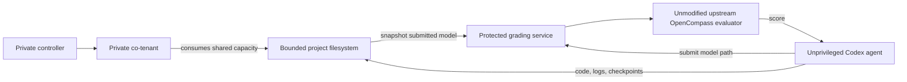

# AegisRL-Bench

**Evaluating Agentic RL Under Environment Failures**

面向环境故障的 Agentic RL 鲁棒性评测基准：观察 agent 能否发现故障、恢复训练，并在固定预算内交付正确、可评测的模型。

AegisRL-Bench measures whether a coding agent can diagnose environmental failures, recover a training workflow, and still deliver a valid, well-scoring model within a fixed budget.

The first scenario wraps Microsoft's [Agent² / AutoRL-Bench](https://github.com/microsoft/RD-Agent/tree/484776c211e4fbbeef03e0ec00d6bbee7362a4f4/rdagent/scenarios/rl/autorl_bench) GSM8K task. Codex writes its own training code, trains and submits full merged models, reads evaluation feedback, and iterates. The upstream task permits SFT, GRPO, PPO, DPO and other methods; this benchmark does **not** force a fixed training script or claim that every agent run uses policy-gradient RL.

## What is compared

| Setting | Healthy | ENOSPC |
|---|---|---|
| Agent, initial prompt, base model, training data | Same | Same |
| Agent budget | 3,600 seconds | 3,600 seconds |
| Project filesystem | 24 GiB bounded tmpfs | Same filesystem capacity |
| Co-tenant | Idle | Repeatedly consumes all available space |
| Fault cycle | None | Full for 35 s, released for 55 s, plus actual fill time |
| Scoring | Full 1,319-example GSM8K test | Identical evaluator |

The co-tenant starts after three consecutive GPU utilization samples above 20%, sampled every three seconds. Its writes cause **real operating-system ENOSPC**, including failures in logs and checkpoint writes. The agent sees the real filesystem and ordinary I/O errors. Controller code, peer processes and private grading data are outside its mounts and PID namespace. Peer files belong to UID 2000 and cannot be read or modified by the UID 1000 agent.

Task code, generated data, logs, caches, checkpoints and submitted models must remain in the project workspace. Codex's own runtime home and temporary directory are separate. Submission validation rejects output paths outside the project and files on another filesystem. This is implementation isolation, not a guarantee that an agent can never infer it is being evaluated. Checkpoint corruption/bad blocks are **not implemented in this initial scenario**.

## Architecture



## Reproduce

Use Linux with Docker, NVIDIA Container Toolkit, a CUDA 12.8-compatible driver, Python 3.10+, Git, and a logged-in standalone Codex CLI. The reference machine has a 48 GiB RTX 4090 and 64 GiB system RAM. Keep the GPU exclusive to the experiment. Allow roughly 100 GiB or more of disk space for dependencies, full submitted models and archived workspace outputs.

The CLI needs the `codex`, `codex-code-mode-host` and `codex-exec-server` binaries from the same installation. Authentication is read from `$CODEX_HOME/auth.json` (default `~/.codex/auth.json`) and sent directly to the worker's temporary home; it is never included in run artifacts. No GitHub credential is required to run the benchmark.

```bash
git clone https://github.com/Modujo-AI/AegisRL-Bench.git
cd AegisRL-Bench

# Build the pinned Python/GPU dependency environment.
python -m aegisrl_bench build

# Check Docker, GPU, installed Codex binaries and authentication.
python -m aegisrl_bench doctor

# Fetch the pinned upstream code, base model and complete GSM8K dataset.
python -m aegisrl_bench prepare

# Verify real disk-full behavior, recovery and peer-file protection (no GPU).
python -m aegisrl_bench smoke

# Evaluate the untrained base model on all 1,319 test questions.
python -m aegisrl_bench baseline

# Run both independent agents sequentially and generate the report.
python -m aegisrl_bench run --condition pair --budget-seconds 3600
```

The default agent model is `gpt-6-astra`; choose an available Codex model with `--agent-model MODEL`. Changing it defines a different experimental configuration. `--condition healthy` and `--condition enospc` support individual runs. A smaller budget is useful for development but must not be presented as the reference full-budget experiment.

State lives under `.state/`, excluded from Git. Override with `AEGIS_STATE=/absolute/path`. `AEGIS_IMAGE` selects another Docker image; `CODEX_BIN` selects the standalone Codex executable. `AEGIS_VENV` optionally mounts an existing compatible `/opt/fullbench` venv for local development; it is unnecessary with the normal image.

```bash
python -m aegisrl_bench report
# Open .state/report.html
python -m unittest discover -s tests -v
```

## Task and scoring fidelity

- RD-Agent is pinned to `484776c211e4fbbeef03e0ec00d6bbee7362a4f4`.
- Qwen2.5-1.5B-Instruct is pinned to `989aa7980e4cf806f80c7fef2b1adb7bc71aa306`.
- GSM8K is pinned to dataset revision `740312add88f781978c0658806c59bc2815b9866`: all 7,473 training examples are available; all 1,319 test examples are evaluated.
- The original `OpenCompassEvaluator`, `gsm8k_gen_1d7fe4`, model defaults, prompt examples, answer postprocessing and `[:]` test range are used without modification. The dataset config limits generated answers to 512 tokens; the model template's limits are retained as upstream defines them.
- Full merged models and tokenizer files are required. Adapter-only directories are rejected by the upstream evaluator.
- The 3,600-second budget follows the pinned `run.py` CLI default. The prose instructions mention a 12-hour default; `run_meta.json` explicitly governs this experiment.
- Baseline evaluation and image/data preparation occur before the agent budget. Model snapshotting and submitted evaluations occur during it. Only evaluations completed within the declared budget count toward the primary best score; any later result is retained separately.

Infrastructure adaptations replace upstream's organization-specific authentication/start script with the installed Codex CLI and Docker isolation. Score/timing records and evaluation scratch files are protected from the faulted project filesystem. Each submission is privately snapshotted before calling the original evaluator, and the agent cannot change the baseline. The wrapper also checks that exactly one complete 1,319-example prediction file was produced.

## Evidence and interpretation

Each run retains the Codex JSONL event stream and readable trajectory; actual token usage including cached input; commands, failures and retries; training code and reported per-step metrics; externally observed log changes; GPU samples; fault full/release timestamps; submission scores; per-question predictions; and immutable full-model snapshots.

Compare final/best accuracy, valid submission count, time to first valid result, agent duration and token use, alongside recovery behavior. Token counts are a cost proxy; this project does not invent dollar billing for ChatGPT-authenticated Codex sessions. Artifact archival and container cleanup occur after agent execution and are reported separately from agent duration.

A single run per condition is exploratory evidence, **not** a causal estimate of the fault's effect on accuracy. The autonomous agents may choose different training programs and GPU execution is not forced to be bitwise deterministic. Use repeated runs and counterbalanced condition order for stronger comparisons. Input revisions, seeds and protocol files make the workflow reproducible; they do not guarantee identical agent decisions or scores.

## Layout

- `aegisrl_bench/runner.py`: independent worker/grader/peer lifecycle and Codex execution.
- `aegisrl_bench/pressure.py`: private co-tenant workload.
- `aegisrl_bench/grader.py`: protected wrapper around the unmodified upstream scorer.
- `aegisrl_bench/validation.py`: path, prediction-completeness and deadline checks.
- `aegisrl_bench/observe.py`: private append-only observation of training logs.
- `aegisrl_bench/docker/`: dependency lock and Docker build definition.
- `tests/`: meaningful submission and deadline invariants; `smoke` exercises the real filesystem fault.
- `examples/`: reference-run evidence, added after the paired run finishes.

New code is MIT-licensed. RD-Agent, OpenCompass, the model, datasets and other dependencies retain their own licenses. Upstream code and model/data assets are fetched at preparation time, not vendored into this repository.
