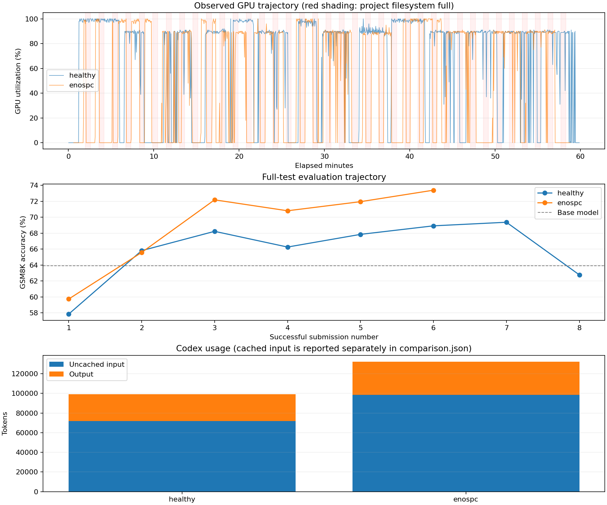
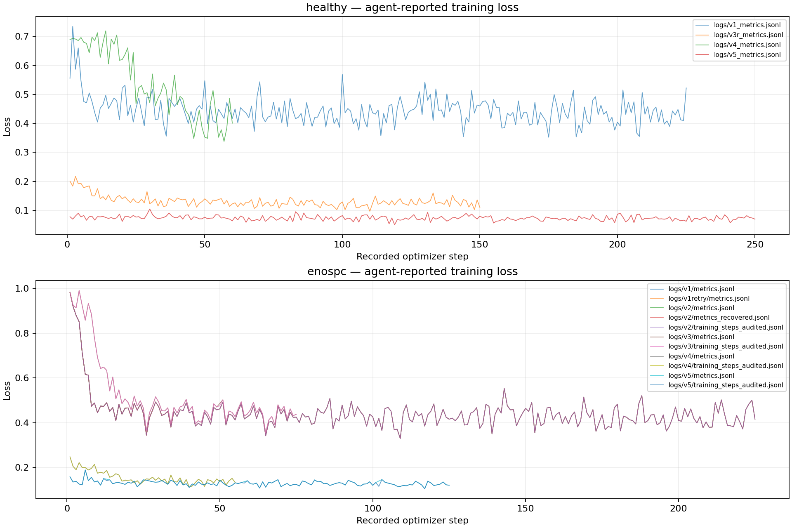

# Reference: GSM8K, healthy versus periodic ENOSPC

Two independent Codex runs, each with a 3,600-second budget, using the full upstream 1,319-question evaluation. Base-model accuracy: **63.91%**.

| Condition | Best accuracy | Valid submissions | Agent seconds | First valid result seconds | Commands | Uncached input tokens | Cached input tokens | Output tokens |
|---|---:|---:|---:|---:|---:|---:|---:|---:|
| healthy | 69.37% | 8 | 3591.9 | 537.6 | 97 | 71,773 | 7,584,256 | 27,323 |
| enospc | 73.39% | 6 | 3493.3 | 841.5 | 90 | 98,481 | 10,464,896 | 33,590 |

Each condition directory includes the complete Codex event stream and readable trajectory, agent-written training code and summary, compressed JSONL logs (including generated solutions), per-step metrics, GPU samples and submission records. The fault condition additionally includes private controller event timestamps. All successful evaluations must have 1,319 predictions; counts are recorded in result.json. Full model snapshots and test predictions remain in the local run archive and are regenerated by reproduction, rather than checked into Git.

These are single-run exploratory results. Agent strategies differ, so an accuracy difference is not evidence that faults improve or impair learning. Token counts are measured usage, not dollar billing.

The reference was executed with the pre-packaging harness preserved under each condition's `provenance/`. The portable runner retains the task/scorer and adds direct temporary credential transfer, explicit submission-completeness validation and cleanup handling. Original machine paths in provenance are historical, not instructions to use those paths. Run the root README commands to reproduce the workflow.

Preparation included an excluded launch where a login-shell PATH hid the installed Python environment; it was stopped before model training and is not included in these results. Official task timing begins after environment preparation. Archival/cleanup time is outside agent duration.
